<a href="https://130-61-149-209.sslip.io">Tropa (live)</a> ·
<a href="https://github.com/DarkIL1ght/ResearchF1Prediction">F1 prediction</a> ·
<a href="https://www.linkedin.com/in/darhan-semiyatov-a5171b3a8">LinkedIn</a> ·
<a href="mailto:Semiatov@mail.ru">Semiatov@mail.ru</a>

The picture is generated by <code>tools/profile.py</code>. The ornament comes from the flag of Kazakhstan (Wikimedia Commons, public domain).
