<!-- Header -->

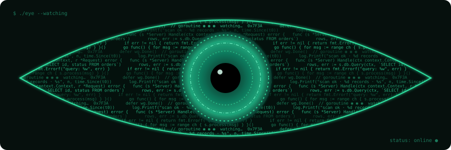



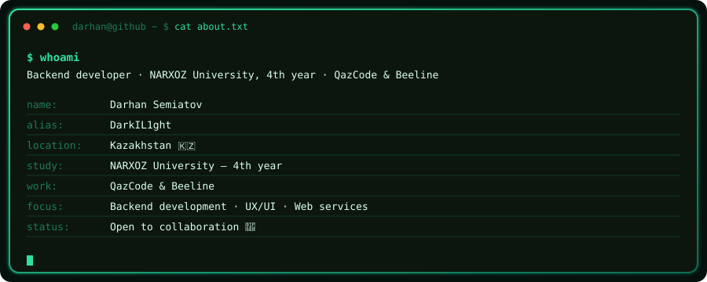

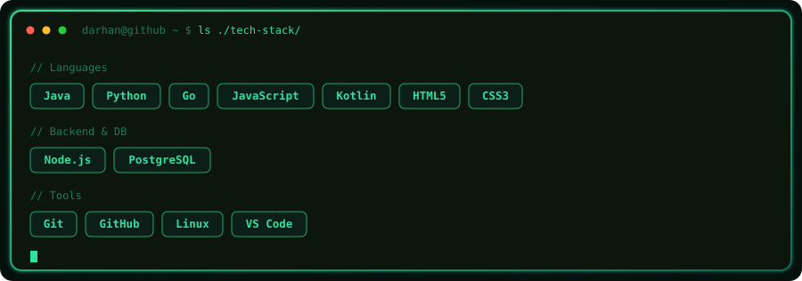

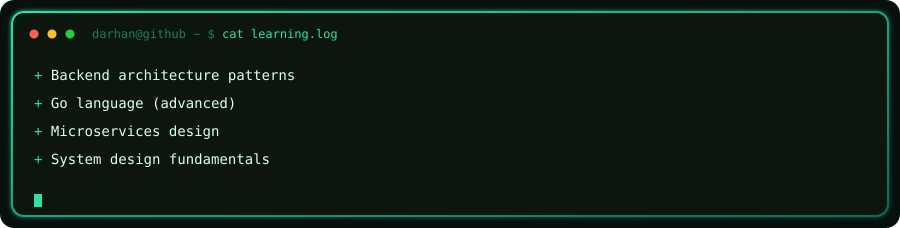

<a href="https://github.com/DarkIL1ght/TextRedactorProjectGo">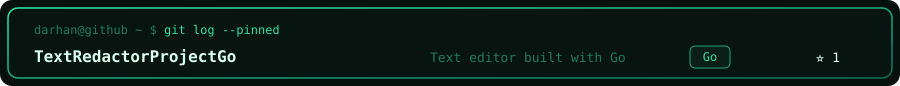</a>
<a href="https://github.com/DarkIL1ght/TcpSERVER">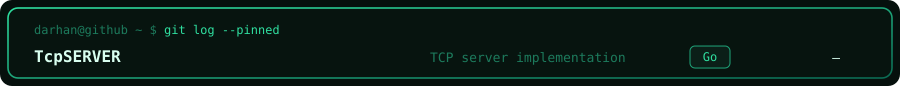</a>
<a href="https://github.com/DarkIL1ght/probproj">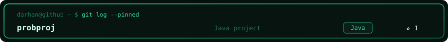</a>
<a href="https://github.com/DarkIL1ght/List-Project">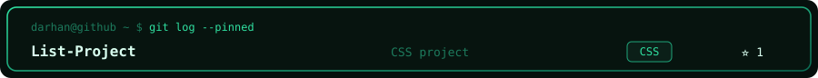</a>
<a href="https://github.com/DarkIL1ght/qadamplus">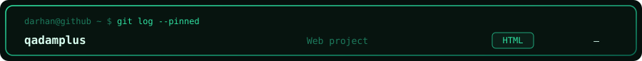</a>

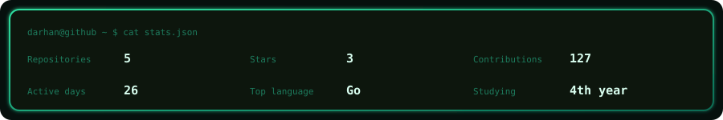

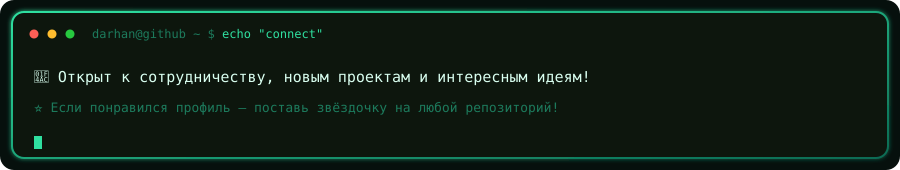

