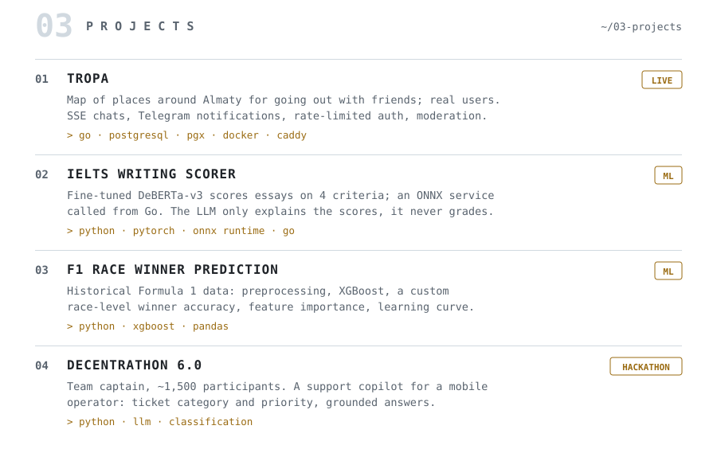

<picture><source media="(prefers-color-scheme: dark)" srcset="assets/dark/header.svg"/></picture>

<a href="https://me.130-61-149-209.sslip.io/en/">Portfolio</a> · <a href="https://www.linkedin.com/in/darhan-semiyatov-a5171b3a8">LinkedIn</a> · <a href="https://t.me/DarkIL1ght">Telegram</a> · <a href="mailto:semiatov@mail.ru">Email</a>

<picture><source media="(prefers-color-scheme: dark)" srcset="assets/dark/projects.svg"/></picture>

<table>
<tr>
<td width="50%"><a href="https://me.130-61-149-209.sslip.io/en/projects/math-lingo"><picture><source media="(prefers-color-scheme: dark)" srcset="assets/dark/card-math-lingo.svg"/></picture></a> <a href="https://me.130-61-149-209.sslip.io/en/projects/math-lingo">case study →</a></td>
<td width="50%"><a href="https://me.130-61-149-209.sslip.io/en/projects/tropa"><picture><source media="(prefers-color-scheme: dark)" srcset="assets/dark/card-tropa.svg"/></picture></a> <a href="https://me.130-61-149-209.sslip.io/en/projects/tropa">case study →</a></td>
</tr>
<tr>
<td width="50%"><a href="https://me.130-61-149-209.sslip.io/en/projects/ielts-scorer"><picture><source media="(prefers-color-scheme: dark)" srcset="assets/dark/card-ielts-scorer.svg"/></picture></a> <a href="https://me.130-61-149-209.sslip.io/en/projects/ielts-scorer">case study →</a></td>
<td width="50%"><a href="https://me.130-61-149-209.sslip.io/en/projects/alash"><picture><source media="(prefers-color-scheme: dark)" srcset="assets/dark/card-alash.svg"/></picture></a> <a href="https://me.130-61-149-209.sslip.io/en/projects/alash">case study →</a></td>
</tr>
<tr>
<td width="50%"><a href="https://me.130-61-149-209.sslip.io/en/projects/m094-diploma"><picture><source media="(prefers-color-scheme: dark)" srcset="assets/dark/card-m094-diploma.svg"/></picture></a> <a href="https://me.130-61-149-209.sslip.io/en/projects/m094-diploma">case study →</a> · <a href="https://github.com/DarkIL1ght/M094Diploma">code</a></td>
<td width="50%"><a href="https://me.130-61-149-209.sslip.io/en/projects/f1-prediction"><picture><source media="(prefers-color-scheme: dark)" srcset="assets/dark/card-f1-prediction.svg"/></picture></a> <a href="https://me.130-61-149-209.sslip.io/en/projects/f1-prediction">case study →</a> · <a href="https://github.com/DarkIL1ght/ResearchF1Prediction">code</a></td>
</tr>
</table>

<picture><source media="(prefers-color-scheme: dark)" srcset="assets/dark/experience.svg"/></picture>

<picture><source media="(prefers-color-scheme: dark)" srcset="assets/dark/stack.svg"/></picture>

<a href="https://me.130-61-149-209.sslip.io/en/"><picture><source media="(prefers-color-scheme: dark)" srcset="assets/dark/footer.svg"/></picture></a>

<!-- generated by tools/profile.py -->
